# Warden Web IDE — Design Document & Technical Specification

**Date:** 2026-10-19  
**Status:** Approved / Planning  
**Target:** New product launched alongside existing `web/` portal, succeeding `web-tui` and eventually replacing the legacy portal.

---

## 1. Executive Summary & Goals

The Warden Web IDE is a next-generation, browser-based developer environment engineered specifically for orchestrating fleets of autonomous coding agents, plans, and pipelines alongside traditional developer workflows (code browsing, terminal execution, and git diff review).

Historically, Warden provided:
1. A dashboard web portal (`web/` - Astro/React) focused on fleet monitoring and admin controls.
2. A terminal-based cockpit (`web-tui`) bridged through `tmux attach`.

The Web IDE merges these worlds into a unified, VS Code-inspired desktop-grade web application. It transitions terminal streaming from `tmux` to native Go pseudo-terminals (**PTY** via `creack/pty`), enables side-by-side git diff inspection of agent worktrees, supports direct code viewing/editing, and provides real-time state reflection across projects.

### Key Goals
- **IDE Experience:** Split, resizable, and collapsible panes for Project Navigation, Detail Workbenches, and Project-Scoped Terminals.
- **Native PTY Streaming:** Direct OS PTY allocation without `tmux` dependencies, supporting interactive shells (AICLI / raw shells) with daemon-side scrollback buffering.
- **Pre-PR Git Diff & Code Review:** Inspect and modify code edits made by agents in real-time before committing or opening pull requests.
- **Project-Centric Multi-Tenancy:** Instant project switching where terminals, files, plans, and agent hierarchies remain strictly scoped to the active project.
- **Incremental, Testable Delivery:** Decomposed into 10 decoupled milestones built component-by-component.
- **Dual Deployment:** Operates standalone locally (embedded in the Go daemon binary) or remotely via `warden-hub` over reverse tunnels with enterprise encryption.

---

## 2. UI / UX Architecture & Layout

The Web IDE UI follows a 4-region layout modeled after modern IDE conventions:

```
+---+----------------------+--------------------------------------------------+
| P | Project Name         | [Agent 1] [main.go] [git-diff]                   |
|---|----------------------|--------------------------------------------------|
| W | ▷ Plans              |                                                  |
| S |   • plan-alpha       |                                                  |
| . | ▷ Agents             |                   DETAIL PANE                    |
| . |   ▾ Autopilot #1     |        (Agent PTY, Plan DAG, Code Editor,        |
| . |     ▾ Pipeline-A     |                  Git Diff)                       |
| W |       • Stage 1 (A1) |                                                  |
| + |       • Stage 2 (A2) |                                                  |
|   | ▷ Code               |                                                  |
|   |   ▾ src/             |                                                  |
|   |     main.go          |                                                  |
|   |   (Width Resizable)  |                                                  |
|===+======================+==============================================[v]=|
|   | [Terminal 1] [+]                                                        |
|   |--------------------------------------------------------------------------|
|   |                                                                          |
|   |                     TERMINAL PANE (Scoped to Project)                    |
|   |                              (Height Resizable)                          |
+---+--------------------------------------------------------------------------+
  ^
  Persistent Activity Bar
```

### 2.1 Region Specifications

1. **Persistent Activity Bar (Far Left, Full Height, Fixed Width: 48px):**
   - **`P` Button:** Toggles visibility of the Project Pane (collapses to 0 width to maximize screen space).
   - **Project Switcher:** Vertical stack of circular project icons (`W`, `S`, etc.). Clicking a project switches the active workspace context across the entire IDE.
   - **`+` Button:** Quick-action dialog to register/open a new project repository.
   - **Bottom Utility Tray:** Settings, daemon health indicator, and connection status.

2. **Project Pane (Top-Left, Width Resizable & Collapsible):**
   - **Header:** Displays active project name and quick-filter bar.
   - **Tree 1: Plans (`▷ Plans`):** Lists project plans and active execution states.
   - **Tree 2: Agents (`▷ Agents`):** Nested relational hierarchy:
     $$\text{Autopilot} \longrightarrow \text{Pipeline} \longrightarrow \text{Stage Agents} \longrightarrow \text{Standalone Agents}$$
     - **Left-Click:** Opens the live interactive PTY terminal for that agent in the Detail Pane.
     - **Right-Click (Context Menu):** Options for *View Git Diff*, *Inspect Telemetry/Info*, *Pause/Resume*, and *Kill*.
   - **Tree 3: Code (`▷ Code`):** Real-time directory and file explorer for project files. Clicking a file opens it in the Monaco Code Editor.

3. **Detail Pane (Top-Right, Tabbed Multi-View Workspace):**
   - Multi-tab header with tab close (`x`) and tab drag-reordering.
   - **Supported Views:**
     - **Agent AICLI Tab:** Live interactive terminal of Claude Code, Aider, or custom agent CLI running in the agent's isolated worktree.
     - **Code Editor Tab:** Monaco Editor with syntax highlighting, search/replace, and auto-save back to the worktree.
     - **Git Diff Tab:** Monaco `<DiffEditor />` displaying side-by-side red/green diffs between the agent's worktree modifications and the base git branch.
     - **Plan & DAG Tab:** Markdown plan description, interactive task checkboxes, and visual pipeline DAG execution graph.
     - **Telemetry / Info Deck:** Detailed token consumption, cost estimates, approval prompt responders, and backoff logs.

4. **Terminal Pane (Bottom, Full Width minus Activity Bar, Height Resizable):**
   - Scoped strictly to the active project (switching from Project A to Project B replaces the terminal tabs with Project B's active sessions).
   - Tab bar with `[Terminal 1]`, `[Terminal 2]`, and `[+]` button to spawn new shells.
   - Right-side `[v]` button collapses the terminal into a compact bottom status strip (~28px high). Clicking it again expands it to its previous height.

---

## 3. Technology Stack & Component Evaluation

| Layer | Selected Technology | Purpose & Architectural Justification |
|---|---|---|
| **Build & Tooling** | **Vite + React 19 + TypeScript** | Sub-second HMR for rapid component iteration. TypeScript enforces strict API contracts that prevent runtime regressions during AI pair-programming. Builds into pure static assets. |
| **Split Pane Layout** | **`react-resizable-panels`** | Lightweight, zero-dependency layout engine by Brian Vaughn. Handles pixel-perfect dragging, minimum/maximum size constraints, and programmatic collapse/expand for sidebars and drawers without layout glitches. |
| **Terminal Rendering** | **`@xterm/xterm` + addons (`fit`, `webgl`)** | Industry-standard terminal emulator. Hardware-accelerated canvas/WebGL rendering capable of streaming thousands of lines of fast agent logs without frame drops. |
| **Code & Diff Editor** | **Monaco Editor (`@monaco-editor/react`)** | The exact editor powering VS Code. Provides native multi-language syntax highlighting and includes the `<DiffEditor />` component for side-by-side git diff review. |
| **Server State & Cache** | **TanStack Query (React Query)** | Acts as a smart asynchronous cache. Deduplicates concurrent requests, handles loading/error states, and enables instant cache patching when WebSocket events arrive. |
| **Client UI State** | **Zustand** | Minimalist store managing transient UI state: active project ID, open tabs, active terminal ID, and collapsed pane flags. |
| **UI Primitives & Styles** | **Tailwind CSS + Radix UI** | Unstyled, fully accessible UI primitives (Context Menus, Modals, Dropdowns, Tooltips) styled with dark-mode IDE aesthetics using Tailwind utility classes. |

---

## 4. Communication Architecture & Data Protocols

```
+-------------------------------------------------------------------------+
|                               Web IDE                                   |
+-------------------------------------------------------------------------+
     | (1) CUD Mutations              | (2) Real-Time Events  | (3) Interactive PTY
     |     POST /spawn, PATCH...      |     WebSocket / SSE   |     Keystrokes & ANSI
     v                                v                       v
+------------------+           +---------------+      +-------------------+
| HTTP REST Router |           | Event Stream  |      | PTY WebSocket     |
| (Existing s.router)          | (State Push)  |      | (Binary Stream)   |
+------------------+           +---------------+      +-------------------+
                                      ^                       ^
                                      |                       |
                             [ Warden State Bus ]      [ creack/pty runner ]
```

### 4.1 CUD (Mutations) via HTTP REST
All state-modifying actions use standard HTTP REST verbs:
- `POST /projects` (Create/Open project)
- `POST /spawn` (Spawn agent or raw terminal)
- `DELETE /sessions/:id` (Kill session)
- `POST /plans/:id/pause` / `POST /plans/:id/resume` (Control plan execution)
- `PATCH /files` (Save code edits)

*Benefit:* Standardized HTTP error codes, idempotent retries, authorization headers, and straightforward network devtools inspection.

### 4.2 Read & Live State Reflection via WebSockets
Rather than polling endpoints repeatedly, read models (projects, plans, agents, pipelines, and autopilot status) are kept synchronized in real time:
1. On initial mount or project switch, TanStack Query loads the snapshot via `GET /tree?project=:id`.
2. A persistent Event WebSocket (`ws://<daemon>/events/ws`) pushes fine-grained change events:
   ```json
   {
     "type": "AGENT_UPDATED",
     "project_id": "warden",
     "payload": {
       "agent_id": "agent-57e83216",
       "status": "busy",
       "current_step": "Running tests"
     }
   }
   ```
3. The client listener immediately executes `queryClient.setQueryData(['tree', projectId], ...)` or invalidates queries. Subscribed components update with zero flicker and zero HTTP polling overhead.

### 4.3 PTY Terminal WebSocket (`/api/pty/:id`)
Each active terminal tab (both raw shells and agent AICLI sessions) maintains an isolated, low-latency WebSocket connection:
- **Upstream (Client &rarr; Daemon):**
  - Binary frames: Keystrokes, control characters (`Ctrl+C`, `Ctrl+D`), and arrow sequences.
  - Text JSON frames: Terminal resize events `{"cols": 120, "rows": 34}` triggered by `FitAddon`.
- **Downstream (Daemon &rarr; Client):**
  - Binary frames: Raw PTY bytes and ANSI escape sequences written directly into `term.write(data)`.

---

## 5. Native PTY Subsystem (Replacing tmux with `creack/pty`)

### 5.1 Daemon Architecture
To eliminate host-level `tmux` dependencies and keybinding conflicts, the Warden daemon manages pseudo-terminals directly via Go's `github.com/creack/pty`:

```go
type PTYSession struct {
    ID        string
    ProjectID string
    Cmd       *exec.Cmd
    PtyFile   *os.File
    Buffer    *RingBuffer // 128KB in-memory circular buffer
    Clients   map[*websocket.Conn]struct{}
    Mu        sync.Mutex
}
```

### 5.2 Scrollback Replay via Circular Ring Buffer
- **Problem:** When using raw PTYs, disconnecting or switching tabs drops stdout history if no client is listening.
- **Solution:** The daemon pipes all PTY output through a 128KB in-memory circular ring buffer (`RingBuffer`). When a client connects or reconnects after a tab switch, the daemon flushes the buffer to the socket before piping live output.

### 5.3 Window Resize & Signal Handling
When the user drags the IDE split panels, `@xterm/addon-fit` calculates the new dimensions and emits `{cols, rows}`. The daemon receives the text frame and invokes:
```go
pty.Setsize(ptySession.PtyFile, &pty.Winsize{
    Rows: rows,
    Cols: cols,
})
```
This sends a `SIGWINCH` signal to the underlying process, triggering seamless line re-wrapping.

### 5.4 Process Lifecycle Isolation
The child process lifecycle is decoupled from WebSocket connection state:
- Closing a terminal tab or closing the browser leaves the daemon-managed process running.
- Explicit termination (`DELETE /api/pty/:id` or terminal exit via `exit` command) reaps the process and closes the PTY master descriptor.

---

## 6. Hosting, Security & Remote Access (Local vs. Warden-Hub)

### 6.1 Local Hosting Mode
- **Zero-Dependency Serving:** The Go daemon embeds the compiled production build using Go's `embed.FS` and serves it on loopback (`http://127.0.0.1:8888`).
- **Authentication & CSRF Protection:** Local access requires a bearer token read from `~/.warden/token`. WebSocket handshakes enforce strict `Origin: http://127.0.0.1:*` checks to prevent Cross-Site WebSocket Hijacking (CSWSH) from malicious browser tabs.

### 6.2 Remote Hosting via Warden-Hub
As specified in `docs/specs/2026-08-23-warden-hub.md`:
- **Outbound Reverse Tunnel:** The local daemon dials outbound to `warden-hub` over WSS with mutual ECDSA certificate authentication, opening a multiplexed `yamux` session.
- **Zero Inbound Ports:** The local daemon requires no open firewall ports or static IP.
- **Web IDE Access:** Users access `https://hub.warden.dev/ide`, log in via OAuth/SSO, and the Hub proxies HTTP requests and PTY WebSockets through the yamux virtual streams.
- **Process Privilege Separation:** All spawned terminal shells run under the local operating system user's UID and GID, scoped strictly to the authorized project directory.

---

## 7. Incremental 10-Milestone Implementation Plan

To ensure testability and prevent monolithic development regressions, implementation proceeds through 10 strictly sequential milestones:

```mermaid
flowchart LR
    M1[M1: Shell Frame] --> M2[M2: Project Switcher]
    M2 --> M3[M3: Project Trees]
    M3 --> M4[M4: Plain Terminal]
    M4 --> M5[M5: Detail & AICLI]
    M5 --> M6[M6: Monaco Code]
    M6 --> M7[M7: Git Diff]
    M7 --> M8[M8: Plans & DAG]
    M8 --> M9[M9: Info Decks]
    M9 --> M10[M10: Live Sync]
```



### Milestone 1: Resizable Shell Frame
- **Scope:** Outer layout using `react-resizable-panels`. Fixed Activity Bar on left, resizable Project Pane, Detail Pane, and Terminal Pane.
- **Verification:** Drag all split borders. Toggle `P` button to collapse/expand Project Pane. Toggle `v` button to collapse/expand Terminal drawer.

### Milestone 2: Project Switcher State
- **Scope:** Zustand store managing `activeProjectId`. Activity Bar renders project avatar list and "Add Project" button. Project Pane header reflects active project.
- **Verification:** Click between project icons; Project Pane header updates instantaneously.

### Milestone 3: Project Pane Hierarchies (Listing Only)
- **Scope 3A:** Plans & Agents tree (`Autopilot` &rarr; `Pipeline` &rarr; `Stage Agents` &rarr; `Standalone Agents`) from `GET /tree`.
- **Scope 3B:** Code directory and file explorer for project root.
- **Verification:** Expand/collapse tree nodes. Switch projects and verify tree updates to the new project's structure.

### Milestone 4: Plain Project Terminals (Go PTY Foundation)
- **Scope:** Daemon `creack/pty` WebSocket endpoint + `@xterm/xterm` bottom pane. Tabs for multiple terminals (`Terminal 1`, `+`). Scoped per project.
- **Verification:** Run interactive commands (`ls`, `top`, `vim`). Resize bottom drawer and confirm text reflow. Switch projects and verify terminal sessions remain isolated.

### Milestone 5: Detail Pane Tabs & Agent AICLI
- **Scope:** Tab management in Detail Pane. Left-clicking an agent in the tree opens an interactive AICLI PTY tab in the Detail Pane.
- **Verification:** Click an agent node; agent terminal opens with live ANSI output and keyboard responsiveness.

### Milestone 6: Monaco Code View
- **Scope:** Clicking a file under `▷ Code` opens a Monaco Editor tab in the Detail Pane with syntax highlighting.
- **Verification:** Open code files, edit text, save, and confirm changes reflect on local disk.

### Milestone 7: Agent Git Diff View
- **Scope:** Right-click agent &rarr; "View Git Diff". Opens Monaco `<DiffEditor />` comparing agent worktree vs. base branch.
- **Verification:** Verify red/green split comparison view with editable modified pane.

### Milestone 8: Plan View & Pipeline DAG
- **Scope:** Clicking a plan opens a Plan Tab rendering markdown specifications, task checklists, and pipeline stage DAG visualization.
- **Verification:** Inspect active pipeline; verify completed, in-progress, and failed stages are color-coded correctly.

### Milestone 9: Telemetry & Info Views
- **Scope:** Right-click context menus for "Agent Info", "Pipeline Info", and "Autopilot Deck" showing token spend, approval gates, and health telemetry.
- **Verification:** Inspect metrics cards and confirm live stats match daemon database values.

### Milestone 10: WebSocket Live Updates
- **Scope:** Wire TanStack Query to the daemon's event WebSocket. Automatically invalidate/patch cache on agent status transitions.
- **Verification:** Run an agent task from the terminal; watch tree node badges update from `idle` to `busy` to `complete` in real-time with zero manual refreshes.
